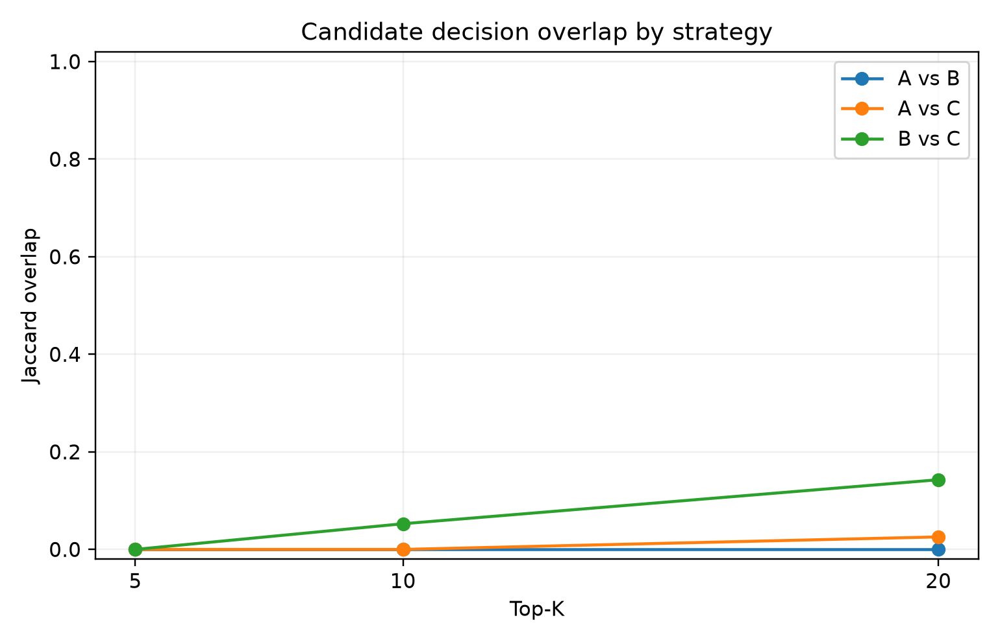
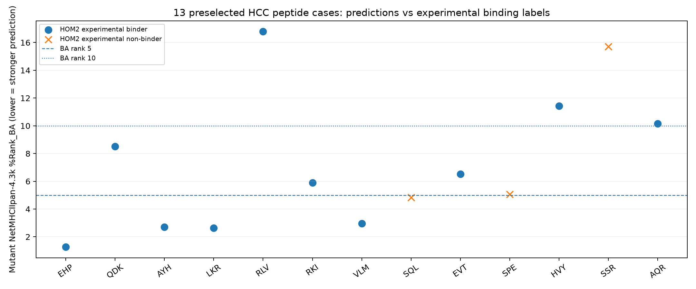

# HCC MHC-II Mutation-Derived Peptide Prioritisation

*A computational case study of peptide ranking, published evidence and proposed experiments*

## Overview

A favourable peptide–MHC class II binding prediction is a useful starting point, but it does not show that a peptide is presented by a tumour or recognised by CD4 T cells. Experimental peptide binding, T-cell recognition, HLA restriction and natural antigen presentation require separate evidence.

I used two HCC-associated missense variants, **TP53 R249S** and **CTNNB1 S45P**, to examine how three different selection rules change the candidates chosen from the same set of predictions. I then checked what the available assay records actually supported and outlined experiments that could address the remaining questions. The emphasis is on making the selection decisions and their evidential limits clear, rather than claiming that one rule predicts immunogenicity better.

The analysis considered overlapping wild-type (WT) and mutant (MUT) peptides of 15, 18 and 21 amino acids, with **HLA-DRB1*01:01** and **HLA-DRB1*04:01** used as hypothetical allele settings. Neither allele was linked to a typed patient, and tumour expression was not verified. Predictions came from **NetMHCIIpan 4.3k** (PEPTIDE input, EL+BA output, context encoding off).

## Research workflow

| Stage | Work undertaken | Output |
|---|---|---|
| Phase 0 | Recorded the NetMHCIIpan 4.3k settings and prediction workflow | Documented prediction settings and input/output procedures |
| Phase 1 | Generated 432 WT and mutant peptide–HLA prediction records | 216 matched WT–mutant comparisons |
| Phase 2 | Applied three candidate selection rules defined after the exploratory pilot | Ranked candidate lists and analysis of overlap between strategies |
| Phase 3 | Reviewed exact-sequence IEDB/CEDAR results and examined the corresponding experimental sources | Six assay annotations covering three TP53 WT control peptides, with unresolved assay attribution documented |
| Phase 3C | Compared NetMHCIIpan predictions with published HOM2 binding classifications for 13 preselected HCC peptides | Retrospective comparison of predicted ranks and experimental binding categories |
| Phase 4 | Developed four candidate-specific experimental proposals with defined decision criteria | Proposed follow-up experiments and decision matrix; no laboratory experiments performed |

### Candidate selection strategies

**A — Absolute binding rank.** Select peptides with low mutant `%Rank_BA`, using the fixed tie-breaks.

**B — Mutation-associated change.** Prioritise positive `WT %Rank_BA − MUT %Rank_BA`, followed by the specified absolute-rank ordering. A positive difference means that the mutant has a more favourable *predicted percentile rank*. It is not a measured change in binding affinity.

**C — Questions for experimental follow-up.** Select candidates that raise specific questions about BA and EL predictions, changes in predicted binding-core offset, or differences between the two HLA settings. This is a rule for choosing informative contrasts, not an immunogenicity classifier.

All three rules used the same 216 correlated comparisons. They were fixed after exploratory pilot work, so the analysis is not a prospective evaluation.

## Main findings

- Of the **216 matched comparisons**, **3** had mutant BA percentile rank ≤5, **4** had mutant EL percentile rank ≤5, and **23** showed a favourable WT-to-MUT BA-rank change.
- The top ten candidates comprised **1, 4 and 5 distinct `(gene, HLA, predicted mutant 9-mer core)` groups** under A, B and C, respectively. Counting *unique core sequences* instead gives **1, 3 and 3**. All ten A candidates, all ten B candidates and nine of ten C candidates came from TP53. These are descriptive measures of list composition, not counts of independently validated epitopes.
- A and B shared **no** top-ten candidates; neither did A and C. B and C shared **one** (Jaccard approximately **0.053**). Different rules produced different lists, but no strategy was shown to be biologically superior.
- The exact-sequence IEDB/CEDAR review found **six T-cell assay annotations relating to three TP53 WT control peptides** from an R248Q/R248W study. These records did not confirm mutant-specific CD4 recognition, allele-specific HLA-II restriction or experimental binding of the R249S/S45P candidates.
- In the separate **13-peptide** HCC comparison reported by Repáraz et al. (2022), **10** peptides were classified as HOM2 binding-score-positive and **3** as negative. A mutant BA rank ≤5 occurred in **4/10 binders** and **1/3 non-binders**. A favourable WT-to-MUT BA-rank change occurred in **8/10 binders** and **3/3 non-binders**. The published binder definition was a competition binding score (**BS > 0.5**), not a measured IC50 cut-off or a CD4 response. Since the peptides had been preselected using an earlier NetMHCIIpan version, these findings cannot provide an unbiased assessment of predictive accuracy.

## Figures

The figures show how the selection rules differ and how predicted BA ranks relate to the published binding categories in the historical comparison.

## Proposed experiments

The [Phase 4 plan](results/phase4/phase4_experiment_plan_v2.md) describes four cases. A, B and C are the original top-ranked candidates under the respective Phase 2 rules; D is an additional, explicitly exploratory CTNNB1 case. It does not alter the frozen rankings.

The proposed work separates direct peptide–HLA-II binding, peptide-pulsed CD4 recognition, allele-specific restriction and recognition following full-length antigen processing. Each stage depends on suitable reagents, controls and a working experimental system. **None of these experiments has yet been performed.**

## Repository contents

- [Full research report](docs/final_research_report.md) — methods, results, interpretation and limitations
- [Reproducibility guide](docs/reproducibility.md) — what can be rerun from this repository and what requires retained external inputs
- `phase2_rules.json` and `phase2_method_lock.md` — fixed selection rules and their provenance
- `results/phase1_extension/analysis/wt_mut_comparison_216.csv` — matched prediction input for Phase 2
- `results/phase2/phase2_all_216_ranked.csv` — full ranking results, alongside Top-K tables and figures
- `results/phase3/historical_comparison/phase3_historical_comparison_13.csv` — retrospective binding comparison
- `docs/provenance/phase3_Shafer_38231165_source_attribution_review.md` — assessment of the TP53 WT-control assay records
- `results/phase4/phase4_experiment_plan_v2.md` and `results/phase4/phase4_experiment_decision_matrix_v2.csv` — proposed experiments and decision matrix

**Reproducibility:** Phase 2 was rerun against the frozen comparison file and rules, with byte-for-byte agreement for the ranked output on 13 November 2026. The public repository does not contain all the original web-service outputs, source PDFs or archived database responses needed to reproduce every earlier stage. See the reproducibility guide for the precise boundary.

## Limitations and interpretation

The historical comparison contains unresolved source-annotation differences: **ELF2 D291E versus D291J**, **ARHGEF40 versus ARHGEF4** for the SPE example, and a legacy **DRB1*01:02** prediction where the present comparison uses **DRB1*01:01**. These have been retained as provenance uncertainties rather than silently resolved. BA and EL percentile ranks are different model outputs; the web service's `BindLevel` should not be treated as a BA-only threshold.

The 216 comparisons arise from just two mutations, not from 216 patients or independent tumour antigens. Published WT-control responses from another study cannot validate R249S mutant recognition. Likewise, the absence of a matching database record does not demonstrate that a peptide is non-immunogenic. The retrospective series is small, selected and affected by allele/provenance uncertainty. None of the results establishes natural presentation by HCC tumours or vaccine efficacy.

## Sources

- Repáraz et al. (2022), *Neoantigens as potential vaccines in hepatocellular carcinoma*, *Journal for ImmunoTherapy of Cancer*. https://doi.org/10.1136/jitc-2021-003978 — source of the historical HOM2 binding categories, not direct R249S/S45P validation.
- Shafer et al. (2024), PMID 38231165. https://pubmed.ncbi.nlm.nih.gov/38231165/ — source context for the TP53 WT-control T-cell annotations.
- IEDB and CEDAR — exact-sequence assay searches, interpreted alongside the source review rather than treated as independent experimental replication.

This is a computational prioritisation and evidence-review study, with proposed experiments for subsequent testing. It is not an experimentally validated vaccine-discovery study.
